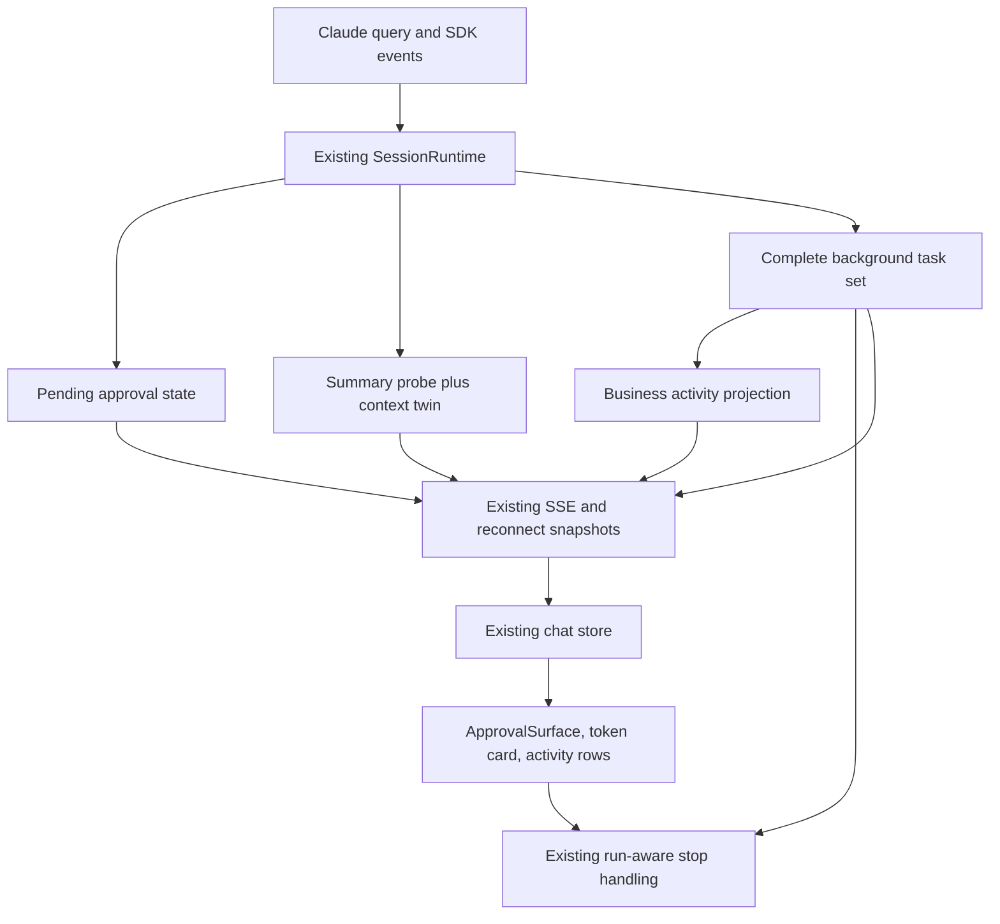
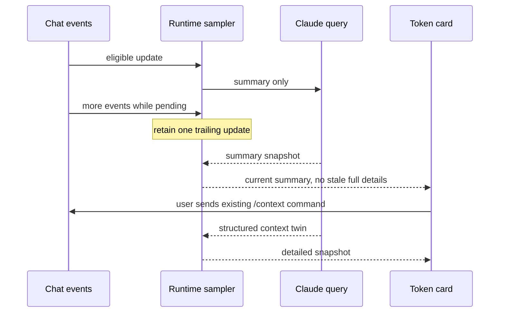
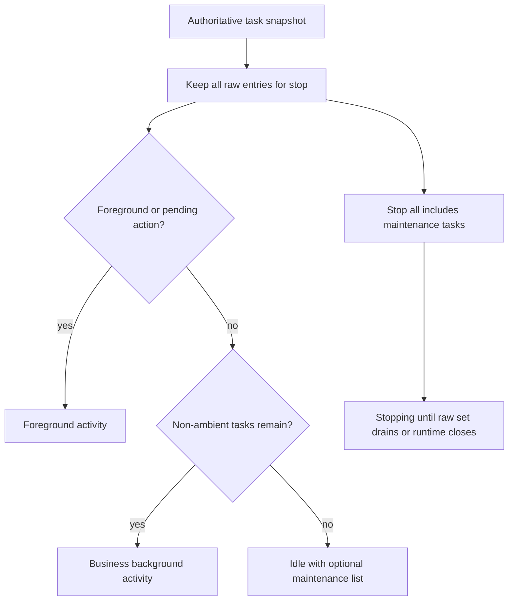

# Claude Capability Enhancements - Plan

## Goal Capsule

- Objective: Comate 用户能看懂上下文占用和后台工作的真实状态，并在需要确认的操作上避免误批准或扩大授权。
- Means: 复用已有审批、上下文卡片和 Session Activity，接入已安装 SDK 的结构化能力（KTD1–KTD6）。
- Authority: 用户授权第二批的调研、优先级确定和方案制定；本轮不授权实现、提交或发布。
- Stop conditions: 不以绕过审批、隐藏仍需停止的任务、伪造后端能力或未经确认发送付费模型请求来实现增强。
- Delivery: 本方案只覆盖下述三个入选方向；后续执行需要另行授权。

---

## Product Contract

### Summary

第二批选择审批提示约束、低开销上下文诊断、后台任务层级与维护活动区分。
优先补齐升级后已经可用、能直接改善现有界面的能力，不引入第二套任务调度器或插件运行时。

### Problem Frame

第一批已随 PR #155 合入 SDK 0.3.301／Claude Code 2.1.301，解决了运行时版本、审批模式、工具结果字段和后台生命周期兼容问题。
但界面仍丢弃 SDK 的审批提示、上下文分类及后台任务元数据：审批卡可能默认聚焦批准，上下文自动探测仍使用昂贵的默认完整统计，任务列表只能展示平铺的类型和描述。
这些缺口会影响个人用户监督长任务和判断上下文余量，且不需要重做 Comate 的通用 Agent 任务工作区架构。

### Capability Assessment

截至 2026-10-16 核对官方 latest release，SDK 仍为 0.3.301，Claude Code 仍为 2.1.301；这不是再次升级依赖的方案。
候选范围包含从上一基线 0.3.237 到当前版本新增的能力，以及更早已存在但 Comate 尚未充分接入的宿主能力，二者不混称为“最新版刚新增”。
优先级是本仓库条件下的判断：先看真实缺口和使用覆盖，再看现有入口可复用程度、SDK 稳定性、安全成本及多后端代价，不用虚构的用户数据打分。

| Priority | Capability | Upstream evidence | Comate gap / value | Decision |
|---|---|---|---|---|
| P0 | 审批默认拒绝、禁止永久放行提示 | SDK 0.3.268 的 `defaultToNo`、`suppressAlwaysAllowRule` | 回调和 pending 状态未传递；卡片仍可默认聚焦 Allow | 纳入，作为第二批交付门槛 |
| P1 | 轻量上下文统计、结构化分类 | SDK 0.3.257 `detail: summary`；0.3.268 `kind` | 多种流式事件触发默认 full；客户端按英文名字判断 Free | 纳入，减少自动探测调用并修正图表语义 |
| P1 | 后台任务来源、层级、维护活动区分 | SDK 0.3.247 `ambient`；0.3.292 `parent_task_id`／`run_id`；0.3.293 `subagent_type` | 第一批内部已有 run 身份，但客户端仍平铺且将所有后台项算作忙碌 | 纳入，增强现有 Session Activity，不新建任务中心 |
| P2 | Skills／命令的会话内刷新 | 已有 `reloadSkills()`、`commands_changed` | 文件清单刷新与 live query 脱节；但 `withSkillReferences` 已逐轮读取显式引用 | 暂缓，仅解决剩余的原生命令/自动发现一致性问题，不能再以“安装后完全不可用”立项 |
| P2 | 完整插件热加载及缓存影响确认 | 已有 `reloadPlugins()`；0.3.268 hold；0.3.301 add | 有缓存/配置服务，但没有完整的在会话中应用/暂缓/失败呈现 | 独立后续方案；`addPlugins` 只增加、不移除，且存在 Windows 沙箱等限制 |
| P2 | MCP 返回文件与资源链接 | SDK 0.3.257 `resourceLinks`、通知 `resource_links` | 工具结果元数据已保留，但缺统一产物呈现与安全打开路径 | 适合通用工作区，待明确资源归属、读取权限和失效行为后实施 |
| P2 | MCP Apps 沙箱界面 | SDK 0.3.280 `_meta.ui`／`readMcpResource`（alpha） | 可增强企业能力包，但不是普通 Markdown 工具卡替换 | 单独设计 iframe/原生壳隔离、CSP、桥接和授权，不能直接渲染服务器 HTML |
| P2 | 内置工具名及历史别名统一 | SDK 0.3.301 公共名称导出 | 可降低权限配置漂移，但“内置”不等于“只读”或“可自动批准” | 后续权限矩阵维护；不批量替换现有只读白名单 |
| P2 | 配额重置、超额状态和 `/usage` 诊断 | SDK 0.3.273、0.3.277、0.3.295 | Comate 已有 Provider Usage，不能将 Claude 订阅额度套给第三方 Provider | 等来源和语义统一；不用带有“不应依赖”声明的实验 usage API 做生产基础 |
| P3 | 旁路提问 `/btw` | 0.3.280 记录了 `askSideQuestion` 行为改善 | 安装包公开 Query 类型没有同名可调用方法；与当前串行输入契约不同 | 先验证公开支持路径，不猜测私有 control request |
| P3 | 启动预热 | SDK 0.3.282 `prewarm`／claim（alpha） | 涉及 Provider、凭据、workspace、Bot 隔离及闲置资源，尚无延迟基线 | 先测量再决定，不建预热进程池 |
| P3 | 原生 Cron、优先 now 输入、前台独立中断 | SDK/CLI 已有相应能力 | 与 Comate 持久化定时任务、串行发送和整个会话 Stop 有重叠或冲突 | 保留现有产品契约，不并行启用第二套语义 |

### Key Decisions

- D1. **增强现有 Comate 表面，而非复刻 CLI。** 沿用用户已确认的范围，避免终端专属交互挤占通用工作区。（session-settled: user-approved — chosen over wholesale CLI feature replication: 先确认可见收益和现有架构可复用性。）Governs R1, R2, R3, R4, R5, R6, R7, R8.
- D2. **本批不做完整热加载。** 显式 Skill 调用已有实时文件路径，剩余价值不足以抵消插件权限与平台适配范围。Governs R8.

### Requirements

**Approval**

- R1. SDK 明确要求 `defaultToNo` 时，审批卡不得默认聚焦批准或允许一键误批准；用户仍可明确点击一次性批准。
- R2. SDK 要求 `suppressAlwaysAllowRule` 时，不提供永久放行，服务端也不得接受该 pending 请求附带的永久授权更新；普通一次性批准和拒绝不变。

**Context diagnostics**

- R3. 自动上下文更新只使用轻量统计，合并同一突发事件的探测，不自动调用 full 统计；用户主动运行现有 `/context` 才请求完整诊断。
- R4. 卡片按结构化 `kind` 区分已占用、空闲、压缩预留和延迟工具，延迟工具不计入已用占比；明确区分摘要、详细结果和旧快照，不把旧明细当作当前详细结果。

**Task supervision**

- R5. 正常后台工作展示任务类型、可用的子 agent 类型及父子归属；缺失或异常关系退回平铺，不能导致任务消失。
- R6. `ambient` 维护任务不制造忙碌徽标和业务任务计数，但保留在可展开的维护列表及运行时停止集合中；整个会话 Stop 仍终止所有后台工作。
- R7. 支持单任务停止的后端中，新客户端按任务的具体 run 显示停止状态并提交停止请求；Comate 已观察到 run 变化时拒绝旧 run 操作，迟到回执不得修改新 run 的界面状态。

**Compatibility boundary**

- R8. 不更改审批模式、Bot 隔离、串行发送、调度系统和整个会话 Stop 语义；Codex/OpenCode、历史记录及缺字段适配器继续可用，缺能力不显示为支持。

### Acceptance Examples

- AE1. Covers R1, R2. 存在审批提示约束的请求经历首次展示和 SSE 重连后，默认焦点仍不在批准上，“始终允许”始终不可见；直接伪造永久授权请求也不能写规则。
- AE2. Covers R3, R4. 连续工具结果产生一批自动统计时，不触发 full；用户发送 `/context` 后看到详细结果，后来的 summary 不再把旧明细伪装成最新结果。
- AE3. Covers R5, R6. 一个业务 agent 带子任务和一个维护 watcher 同时运行时，只业务任务影响忙碌计数；业务任务结束后 UI 可以空闲，维护项仍可展开并停止。
- AE4. Covers R7. 同一 task ID 从 run A 恢复为 B 且 Comate 已收到 B 的快照后，A 的停止请求被拒绝；A 的回执不能清理 B 的停止状态，用户对 B 的新停止操作仍可执行。
- AE5. Covers R8. OpenCode 只返回旧版上下文分类和无 run ID 的任务时，界面维持旧行为，不自动调用不存在的 Claude 控制 API。

### Scope Boundaries

不升级第二个版本、不更改模型默认值、不自动 compact、不改系统 Claude 安装，不实现按父任务批量停止或将停止父项解释为停止整棵树。
不新增通用 capability 注册框架、跨后端控制协议或数据库迁移；现有类型以可选字段扩展。
不因新提示字段擅自把用户选择的 Comate auto 模式改为 manual；提示仅约束实际进入人工审批的请求，不作为新的审批模式开关。
暂不将审批限制扩展成全局永久授权管理器：本批只约束被标记的 pending 请求，现有规则治理保持原边界。

#### Deferred to Follow-Up Work

P2/P3 候选均不进入本方案 Implementation Units。
Skills 原生发现一致性和插件热加载应复用 `commands-store` 的 session scope，先验证真实缺口，不能改回独立安装器或改写现有 skill-manager 工作流。
任务产物链接与 MCP Apps 需要独立安全边界设计；预热需有性能数据后再立项。

---

## Planning Contract

### Key Technical Decisions

- KTD1. **保留现有会话入口。** 将 SDK 的两个提示作为可选布尔元数据贯穿 callback、pending state、实时事件、重连快照和 ApprovalSurface，服务端在 resolution 前校验 R2；复用现有 browser handler-owned 审批，不制造第二张卡。与 D1、R1、R2、R8 对齐。
- KTD2. **摘要控制请求和 `/context` 详细结果分工。** 现有 `emitContextUsage` 自动路径显式使用 summary，并采用每 runtime 单个在途请求加一次 trailing 更新，关闭后不再发布；详细入口仍用已有聊天命令和结构化 `context_usage` twin，不增加一条特权 HTTP 路由。`/context` 自身的结束事件不触发覆盖其结果的自动摘要，后续真实对话变化才恢复采样。实现 R3。
- KTD3. **一次归一化、两类来源。** SDK control response 和 `/context` twin 保留 `kind`，Comate 事件及快照附带可选的 detail/freshness 信息；用 runtime 内的观测代次丢弃落后于较新详细结果的在途探测，后续对话变化产生的新 summary 清掉已失效的 detailed 区块。缺 `kind` 的老适配器保留原回退逻辑，不能用英文名覆盖 SDK 的明确分类。实现 R4、R8。
- KTD4. **原始任务集合与业务活跃投影分离。** 仍以 `background_tasks_changed` 的整集替换为权威，原始集合保留 ambient/parent/run/type；activity 仅由业务任务、前台、pending 和 stopping 推导。审查 `stopAll` 的 idle 早退、空闲回收和中断记录，避免用“业务空闲”等价“无进程工作”。实现 R5、R6，不另建任务状态机。
- KTD5. **run 身份贯穿停止 UI 到现有路由。** 可选 run ID 加入 SessionBackgroundTask 和停止请求；明确提供但不匹配宿主已观察的当前 run 时拒绝，不下发 SDK Stop；旧调用未携带 run ID 时保留已有按 task ID 语义。迟到单任务回执不清掉新 run 的 pending 状态。SDK 的 `stopTask` 及 control request 仅接受 task ID，因此不承诺 CLI 接收瞬间的原子 run 条件停止，也不发明私有 run 参数。实现 R7、R8。
- KTD6. **只读投影不能创造控制权。** 父子关系仅用于呈现，不从名称推断关联，不让新 UI 绕过后端 capability 判断或跨 workspace/session 停止；unknown parent、环和自引用节点平铺展示。实现 R5、R8。

### Existing Evidence

- `src/server/services/session-runtime.ts`：五类流式事件触发 `emitContextUsage()`，无参数调用 SDK 因而取默认 full；任务快照只投影 id/type/description；第一批已按 run 去重停止操作。
- `src/server/services/sse-emitter.ts`：已有 `/context` twin 结构化路径，但把 deferred 转成布尔而丢弃其他 kind；应扩展现有路径，不再解析 Markdown 表格。
- `src/client/components/SessionTokenUsage.tsx`：已有分类条及明细 popover，仍使用英文 Free 名称过滤；无需新建诊断页面。
- `src/client/components/ApprovalSurface.tsx`、`src/server/services/session-runtime.ts`：批准按钮的默认焦点、suggestions 及重连 pending 状态是 R1/R2 的落点。
- `src/client/components/PromptInput.tsx`、`src/client/stores/chat-store.ts`：后台任务行、计数、停止 pending 和 SSE 消费已有入口。
- `src/server/services/skill-input.ts`、`src/server/services/session-skills.ts`、`src/server/routes/workspace-commands.ts`：显式 Skill 引用逐轮从文件解析并受权限过滤；不能把原生自动发现不足概括成“Skill 必须重启才能用”。
- `docs/plans/2026-10-16-2233-fix-claude-sdk-upgrade-plan.md`、`docs/plans/2026-07-30-003-fix-claude-sdk-session-activity-plan.md`：既有 Stop、快照权威及串行输入契约。
- `docs/solutions/conventions/use-isolated-test-database-for-comate.md`、`docs/solutions/integration-issues/sdk-sandbox-loopback-requires-proxy-egress.md`：隔离测试数据与 Bot 网络边界不能因验证方便而绕过。

### High-Level Technical Design

### System-Wide Impact

共享 SSE 类型目前位于 `src/server/types/message.ts` 与 `src/client/types/message.ts`，两端同步做增量扩展，不借机合并类型系统。
`chat-store` 的快照比较、历史恢复和 task stop key 都必须识别新字段，否则事件可能被忽略或旧停止状态附着到新 run。
业务活跃投影影响聊天、侧栏状态、Bot/调度运行完成判断及空闲回收，需要沿 onActivity 消费链回归，而不仅测任务行。
不新增 agent 专属工具：详细诊断仍是可由用户和已获授权调用方使用的既有 `/context` 会话命令；监督与停止继续使用既有 API 和原有认证，不开放新的 session-token 路由。
对于无 Claude 控制能力的后端，只应用可验证的通用显示逻辑；不调用插件重载、预热或私有控制请求。

### Risks and Alternatives

- 选择请求合并而非逐事件探测：当前多事件触发可以形成并发 full 调用；不增加轮询器或固定后台定时探测。
- 选择 `/context` 而非新 full 诊断 HTTP API：已有 twin、聊天输入与鉴权可用，避免为只读入口扩展受权面；详细命令沿用串行队列，不抢占当前回合。
- 选择任务集合上的纯投影而非持久化任务树：任务本身来自当前 CLI 进程，不把历史 metadata 复活为运行中任务；缺关联信息即可平铺，无需新数据库。
- SDK summary 仍有本地估算；UI 需要说明摘要性质，不能承诺账单金额或把 tokens 转成未验证的第三方 Provider 价格。
- run 条件停止只能约束宿主已观察状态：CLI 在检查后、执行 Stop 前自行恢复同一 task 的竞态，现有 SDK 无法原子排除；不将 U4/U5 的通过宣称为该上游缺口已解决，若未来需要严格保证，须等待公开的 expected-run 支持。
- 不新增 SDK MCP per-tool policy：本批没有新宿主工具，现有浏览器安全清单仍由 handler 拥有；后续新工具接入再单独验证 always_ask/deny 与 Comate policy 的交互。

---

## Implementation Units

### U1. Preserve approval interaction constraints

**Goal:** 受 SDK 提示约束的审批在首次展示、重连和服务端响应时保持同一限制。
**Requirements:** R1, R2, R8; AE1.
**Dependencies:** None.
**Files:** `src/server/services/session-runtime.ts`, `src/server/services/chat-service.ts`, `src/server/services/sse-emitter.ts`, `src/server/routes/chat.ts`, `src/server/types/message.ts`, `src/client/types/message.ts`, `src/client/stores/chat-store.ts`, `src/client/components/ApprovalSurface.tsx`，及对应 `session-runtime.test.ts`、`chat-service.test.ts`、`sse-emitter.test.ts`、`chat.test.ts`、`chat-store.test.ts`、`ApprovalSurface.test.tsx`。
**Approach:** 按 KTD1 贯穿 GUI 和实际调用 requestToolApproval 的 Bot 路径，补上 pending 记录和重放；在消耗 pending 前拒绝禁止的永久授权请求，错误不能令卡片失效。
**Execution note:** 先为焦点、重连及伪造永久放行请求建立失败回归。
**Test scenarios:**
- Covers AE1. 两个提示同时存在，默认焦点及快捷键不触发批准，明确点击一次性批准仍成功。
- SSE 重连重建 pending 后提示不丢失；两个并发审批的限制互不串用。
- 客户端隐藏按钮但 API 仍收到 updatedPermissions 时，服务端拒绝且 pending 保留供合法选择。
- 无提示字段、已有浏览器安全清单及 Bot 升级审批维持原行为。
**Verification:** 审批 UI、路由和 callback 端到端约束一致，没有新增自动授权或重复浏览器卡片。

### U2. Bound automatic context sampling

**Goal:** 自动更新只走摘要路径，并在事件突发和会话关闭时保持请求有界。
**Requirements:** R3, R8; AE2.
**Dependencies:** None.
**Files:** `src/server/services/session-runtime.ts`, `src/server/services/backend-driver.ts`（仅必要的能力声明）, `src/server/services/session-runtime.test.ts`, `src/server/services/codex-adapter.test.ts`, `src/server/services/opencode-adapter.test.ts`。
**Approach:** 实现 KTD2 的请求合并，保留完整诊断的现有命令路径；非 Claude 适配器按自己的可用统计降级，不引入通用新控制层。
**Test scenarios:**
- Covers AE2. 一批 start/tool/result 事件只产生串行 summary 调用，无自动 full 调用。
- 探测在途又有变化时最终数据不丢失；失败后下一批事件仍能重新探测。
- 关闭或更换 runtime 后迟到结果不再发出；没有活跃 query 时不为探测启动进程。
- Covers AE5. Codex/OpenCode 的既有上下文返回继续可用，不要求它们支持 Claude 参数语义。
**Verification:** 自动路径的 full 调用数为零、单 runtime 同时在途探测不超过一个，mock 之外由隔离真实 CLI 验证 summary 控制请求。

### U3. Present typed context diagnostics

**Goal:** 当前摘要和用户请求的完整诊断使用准确且可解释的分类展示。
**Requirements:** R3, R4, R8; AE2, AE5.
**Dependencies:** U2.
**Files:** `src/server/services/sse-emitter.ts`, `src/server/types/message.ts`, `src/client/types/message.ts`, `src/client/stores/chat-store.ts`, `src/client/components/SessionTokenUsage.tsx`, `src/client/i18n/en/chat.json`, `src/client/i18n/zh-CN/chat.json`, `src/server/services/sse-emitter.test.ts`, `src/client/stores/chat-store.test.ts`, `src/client/components/SessionTokenUsage.test.tsx`。
**Approach:** 按 KTD3 扩展两条已有归一化路径，沿现有 card 呈现来源和有效明细；完整诊断入口提示并使用 `/context`，不解析命令 Markdown。
**Test scenarios:**
- Free/Buffer/Deferred 的显示名变化或非英文时，仍按 kind 计算和分组。
- Deferred 行即使很大也不进入 used 条；buffer 作为预留独立展示，不伪装成用户内容。
- Covers AE2. `/context` 的结束事件不擦掉刚展示的明细；后续真实对话变化产生的新 summary 清掉旧明细，迟到的旧代次探测不能覆盖较新的命令诊断。
- 缺 kind、未恢复 freshness 的旧快照仍可读，展示旧快照而不是声称刚完成测量。
- Covers AE5. 只有估算统计的后端不显示不可用的完整 Claude 诊断入口。
**Verification:** 实时结果、重连数据及历史卡片口径一致，明细失败不覆盖仍有效摘要。

### U4. Separate task inventory from business activity

**Goal:** 保留全部停止目标，同时让 Session Activity 真实表达业务工作。
**Requirements:** R5–R8; AE3, AE4.
**Dependencies:** None.
**Files:** `src/server/services/session-runtime.ts`, `src/server/types/message.ts`, `src/client/types/message.ts`, `src/server/services/chat-service.ts`, `src/server/routes/chat.ts`, `src/server/services/session-runtime.test.ts`, `src/server/services/chat-service.test.ts`, `src/server/routes/chat.test.ts`。
**Approach:** 按 KTD4–KTD6 保留 snapshot 元数据并修改 activity 比较；现有 stop 路由增加可选 run 身份校验。所有清理和停止遍历仍使用原始集合，不使用可见业务任务数判断排空。
**Execution note:** 先表征当前 Stop fence、晚到快照和同 ID 恢复行为，再改变 active 投影。
**Test scenarios:**
- Covers AE3. 仅 ambient 的 snapshot 不产生业务忙碌，但 `stopAll` 仍调用 stop/interrupt 并验证排空。
- mixed snapshot 的业务任务结束后，ambient 条目仍保留；ambient 标记改变可触发新投影。
- Covers AE4. 对旧 run 的显式 stop 返回冲突且不调用 SDK，新 run 的 stop 可独立成功。
- 结束通知先于空 snapshot、Stop 后出现新任务、停止失败、流异常、孤儿 parent 均不提前丢弃原始任务。
- Bot/调度完成和空闲回收不因维护项永久卡住，也不把非 ambient 后台工作误判为已完成。
**Verification:** Session Activity、状态消费链和停止回归通过，第一批已验证的 Stop 契约未被可见性过滤破坏。

### U5. Show task hierarchy and run-aware controls

**Goal:** 用户能区分业务任务与维护项，并对看到的具体任务运行执行停止。
**Requirements:** R5–R8; AE3–AE5.
**Dependencies:** U4.
**Files:** `src/client/stores/chat-store.ts`, `src/client/components/PromptInput.tsx`, `src/client/components/PromptInput.browser.test.tsx`, `src/client/stores/chat-store.test.ts`, `src/client/i18n/en/chat.json`, `src/client/i18n/zh-CN/chat.json`，及必要的 co-located 任务展示 helper/test 新文件。
**Approach:** 在已有 activity 区域按 KTD6 展示父子缩进、子 agent 类型和默认收起的维护项；停止 pending key 使用 run 身份，409 清除旧 pending 并获取当前 activity，不自动替用户停止新 run。
**Test scenarios:**
- Covers AE3. 子任务顺序不依赖父项先到；维护列表不进入业务 badge，但允许支持后端的显式停止。
- 环、自引用、已结束父项和未知类型回退为可见行，不递归溢出或重复计数。
- Covers AE4. A 的 stop 回执晚于 B 的新行到达时，B 不显示 A 的 spinner，B 的按钮仍可用。
- Covers AE5. 缺元数据的旧事件和非 Claude 后端平铺展示，无不支持的停止按钮。
- 窄屏、键盘导航和中英文文案保持可操作，展开维护项不改变整个会话 Stop 的覆盖范围。
**Verification:** 浏览器测试覆盖新老事件、冲突和切会话；不得新建独立任务管理页或改变 TaskPanel 的计划事项含义。

### U6. Verify the bounded enhancement batch

**Goal:** 三个入选方向通过跨层回归，且没有把延期项带进 diff。
**Requirements:** R1–R8.
**Dependencies:** U1–U5.
**Files:** `CHANGELOG.md`、上述集成测试，必要时增加 `src/server/services/sdk-enhancement-contract.test.ts`，以及现有 `src/server/services/sdk-rule-contract.test.ts`、`src/server/services/loopback-auth-contract.test.ts`。
**Approach:** 使用隔离数据和本地脚本化 Provider fixture，证明真实 CLI 的摘要、审批提示和 task snapshot 形状；复用既有打包 smoke，不访问真实用户会话或付费 Provider。
**Test scenarios:**
- 真实 SDK 配合模拟回调/transport 的形状证据分别注明，不能把仅 mock 的 hint 路径声称为 native 产生。
- 首次订阅、断线重连、重启加载旧历史、Bot/调度完成和非 Claude 后端回归均有结果。
- sidecar 打包继续加载同一 SDK/native 对，UI 和 server 的增量字段契约一致。
**Verification:** Verification Contract 全部有结果；平台或无法原生产生的场景如实标为未验证。

---

## Verification Contract

本轮只制定方案，不运行测试或构建；以下是后续实现必须提供的证据，不是已通过声明。

| Gate | Scope | Exit evidence |
|---|---|---|
| 定向 server 回归 | U1–U4、U6 的 runtime、emitter、chat route、adapter tests | AE1–AE5 的服务端约束成立，含并发/重连/迟到事件 |
| 客户端与浏览器回归 | `npm run test:client`；`npm run test:browser` 中受影响的 PromptInput 场景 | 分类、焦点、任务树、维护项和 run-aware Stop 可操作 |
| 真实 CLI contract | SDK contract fixtures 与审批/沙箱既有回归 | summary 控制请求、隔离策略、原生事件形状有对应证据 |
| 静态与全量 | `npm run lint`、`npm run typecheck`、`npm test` | 全量通过；既有失败独立列明，不削弱断言 |
| 打包 | `npm run build:sidecar` 与既有 packaged smoke | SDK 0.3.301／CLI 2.1.301 保持一致，打包应用能走真实生产入口 |

server 测试第一条 import 必须是 test-env，使用隔离 SQLite/HOME/data。
Bot loopback 合同继续经已有 sandbox proxy；不通过放宽认证、关闭沙箱或改用生产数据来让验证通过。
macOS 本机和已打包架构的执行结果分别记录；Linux/Windows 未执行不能等同于通过。

---

## Definition of Done

R1–R8、AE1–AE5 由对应 U1–U6 的证据证明；P0 审批约束未通过时不把 P1 功能标为可交付。
automatic full 探测为零，已延迟工具不计入上下文 used，占用图不会混用旧详细数据与当前摘要。
任务树不会隐藏任务，ambient 不制造业务忙碌，整会话 Stop 仍覆盖原始任务集合；宿主已知的旧 run 操作被拒绝，停止 UI 不被旧回执污染，SDK 侧竞态限制已说明。
旧历史、无新字段适配器、Codex/OpenCode、Bot 和调度路径保持兼容；新增字段不能成为对旧数据的强制要求。
用户能检查完整 diff、变更日志、真实验证范围和限制；删除失败试验及未使用代码，不夹带 P2/P3 功能或未经请求的依赖更新。

---

## Appendix

### Official Sources

- [SDK 0.3.301](https://github.com/anthropics/claude-agent-sdk-typescript/releases/tag/v0.3.301)：当前版本、SDK MCP policy、公共工具名、addPlugins。
- [Claude Code 2.1.301](https://github.com/anthropics/claude-code/releases/tag/v2.1.301)：当前 CLI 基线与已随升级取得的上游修复。
- [SDK 0.3.268](https://github.com/anthropics/claude-agent-sdk-typescript/releases/tag/v0.3.268)：审批提示、kind 与缓存影响 hold。
- [SDK 0.3.257](https://github.com/anthropics/claude-agent-sdk-typescript/releases/tag/v0.3.257)：summary 与 MCP 资源链接。
- [SDK 0.3.247](https://github.com/anthropics/claude-agent-sdk-typescript/releases/tag/v0.3.247)、[0.3.292](https://github.com/anthropics/claude-agent-sdk-typescript/releases/tag/v0.3.292)、[0.3.293](https://github.com/anthropics/claude-agent-sdk-typescript/releases/tag/v0.3.293)：维护任务、父子/运行身份、子 agent 类型。
- [SDK 0.3.280](https://github.com/anthropics/claude-agent-sdk-typescript/releases/tag/v0.3.280)、[0.3.282](https://github.com/anthropics/claude-agent-sdk-typescript/releases/tag/v0.3.282)：MCP Apps、旁路提问行为与预热。
- [SDK 官方 changelog](https://github.com/anthropics/claude-agent-sdk-typescript/blob/main/CHANGELOG.md)：其余候选的逐版本记录。

SDK 具体限制以本批已安装 0.3.301 的 `sdk.d.ts` 为准：`reloadPlugins`/`reloadSkills` 是公开方法；`addPlugins` 不提供移除列表；预热和资源读取含 alpha 声明；usage 控制方法明确带实验性警告；Query 没有公开 `askSideQuestion` 方法。
版本发布说明说明“有什么”，本仓库文件和测试决定“是否尚缺、能否直接接入”；优先级及第二批取舍是本方案基于两者作出的判断。
